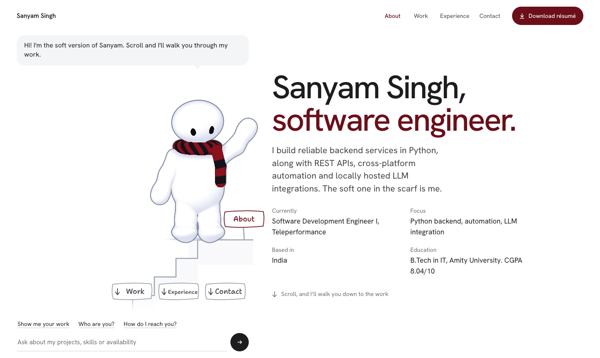

# Sanyam Singh, portfolio

A developer portfolio hosted by a soft, drawn character. He walks you down a staircase as you scroll, catches the project you click and holds it up, answers questions about my work, and reacts to how you treat him.

**Live site: [itsamesanyam.netlify.app](https://itsamesanyam.netlify.app)**



## What it does

- **Walks with your scroll.** One continuous staircase runs the length of the page, and each section ends on a landing beside its content.
- **Catches projects.** Click a project and the tile flies into his hands, then grows into the full view: the problem, what I built, and where it stands.
- **Answers questions.** Ask about projects, skills or how to reach me. Answers come only from one content file, and anything else gets an honest "I don't have that in my portfolio yet".
- **Reacts to you.** He looks at your cursor and follows it along the stairs. You can grab and throw him. He gets out of breath if you scroll fast, and sits down and falls asleep if you leave him alone.
- **Links skills to proof.** Click a skill and the projects that use it light up while he points at them.
- **Stays out of the way.** Experience, skills and contact details are plain text on the page, so nobody has to talk to a character to find them.

On phones he folds into a small strip while you read. Tap him to bring him back full size, drag and throw him with a finger, tap the stairs to send him somewhere, and he steps out to make the catch.

## How the figure works

He isn't a 3D model, a video or an animation file.

- **His body** is a shape defined by maths (a signed distance field), drawn pixel by pixel in a hand-written GLSL shader and shaded to look soft and drawn. See [figure/shader.ts](figure/shader.ts).
- **His behaviour** is plain TypeScript with no React in it: walking, poses, drag and throw physics, the spring-driven scarf, and his reactions. See [figure/avatar.ts](figure/avatar.ts).
- **The page** and the figure only talk through events and method calls, so each can change without the other. See [components/Portfolio.tsx](components/Portfolio.tsx) and [components/Stage.tsx](components/Stage.tsx).

## Built with

Next.js 16, React 19, TypeScript, React Three Fiber and Three.js (for the canvas and render loop), GLSL and plain CSS. There is no backend, database or AI model: the question box is keyword matching that runs in the browser, in [lib/assistant.ts](lib/assistant.ts).

If WebGL isn't available the page shows a static figure, and `prefers-reduced-motion` is respected.

## Run it locally

Requires Node.js and npm.

```bash
npm install
npm run dev        # http://localhost:3000
npm run build      # production build
npm run start      # serve the production build
npm run typecheck  # TypeScript check
```

## Project layout

```
app/                  Layout, metadata, styles, share image, favicon
components/
  Portfolio.tsx       The page, conversation, project catch, skills, phone layout
  Stage.tsx           Canvas and everything that rides along with the figure
figure/
  avatar.ts           The figure's behaviour
  shader.ts           How the figure and stairs are drawn
content/portfolio.ts  Every fact on the site, in one file
lib/assistant.ts      Answers questions from that file
public/               Résumé PDF
```

## Changing the content

Everything lives in [content/portfolio.ts](content/portfolio.ts). The page and the figure's answers both read from it.

- **Projects:** the first one gets the large "Start here" tile. Set `liveUrl`, `sourceUrl`, `image` and `shots` as they become available, and they appear on their own. A shot with a `video` plays through before the stills, using its `image` as the poster. Media lives in `public/projects/`. Each project's `questions` are what the figure offers while it's open (three at a time), and typed questions containing one of a question's `keys` get its answer.
- **Skills:** a project's `skills` must use the same names as `skillGroups`, or clicking a skill won't find it.
- **Contact:** a LinkedIn or GitHub row stays hidden until its `href` is set.
- **Résumé:** replace `public/Sanyam_Singh_Resume.pdf`, and keep `resumeUrl` as `/Sanyam_Singh_Resume.pdf`.

## Deploying

The live site runs on Netlify and redeploys when `main` is pushed.

| Setting | Value |
|---|---|
| Build command | `npm run build` |
| Publish directory | `.next` |

Netlify provides the site's address to the build, which the share preview uses. On another host, set `NEXT_PUBLIC_SITE_URL` to the public address.

## Status

The site is live. breakAPI and GiggleGig have screenshots, a walkthrough video and links; the Academic Publication Profiler's are still to come. There are no automated tests yet.
